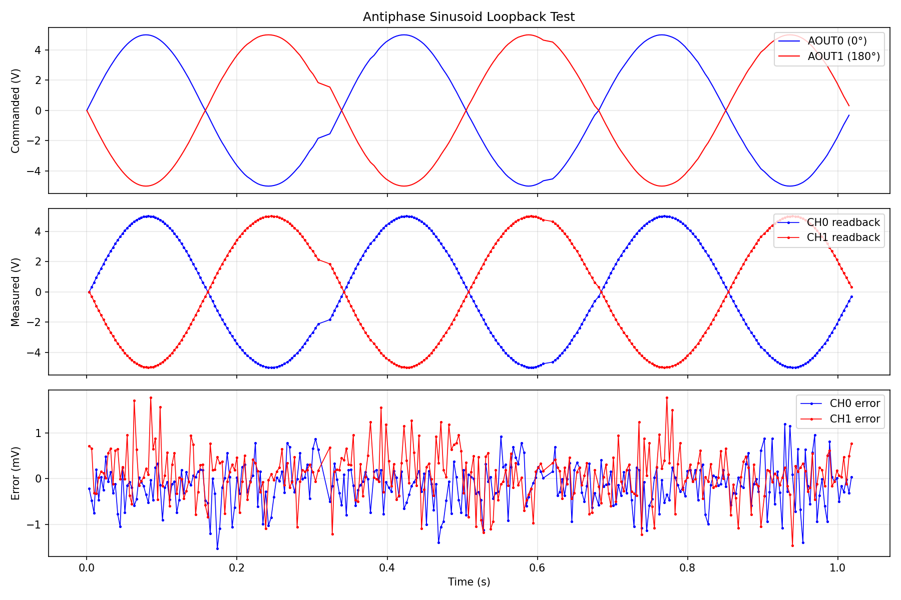
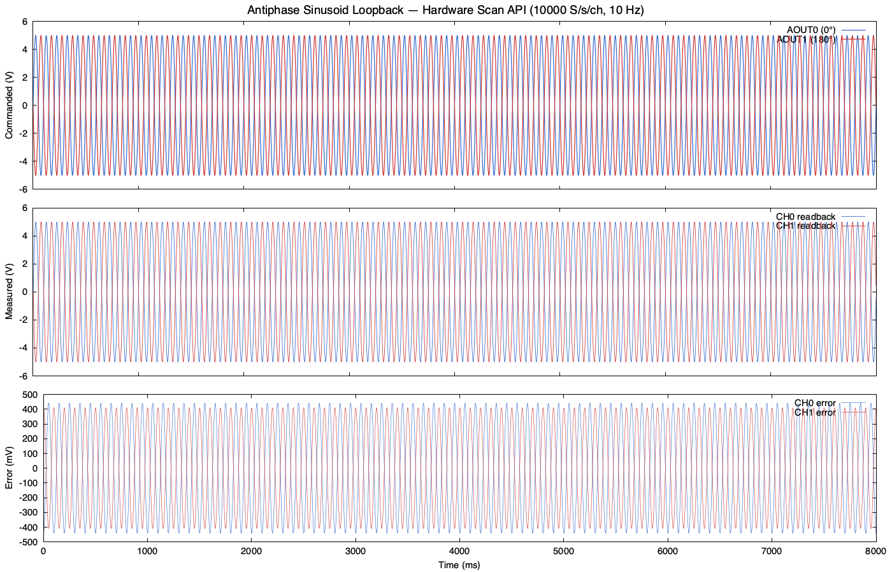

# Brock treadmill DAQ
Code for reading/writing from the MCC USB-1608GX-2AO.

The Python side talks to the device directly over USB with its own driver
(`mcc1608g/`). No MCC libraries, kernel drivers or InstaCal needed, and the
same code runs on Linux, macOS and Windows.

Runnable:
- `uv run loopback` — step voltages on AOUT0/1, read back on CH0/1 (Py)
- `uv run sinusoid` — software-timed antiphase sinusoid loopback (Py)
- `uv run sinusoid-scan` — hardware-paced antiphase sinusoid loopback (Py)
- `uv run forceplate_gui.py` — force-plate calibration GUI (captures + loopback mode)
- `uv run forceplate.py calib_data/<session>` — solve the 6x12 calibration matrix
- `uv run compare-uldaq` — cross-check our driver against MCC's uldaq (Py, optional)
- `./sinusoid_loopback` — hardware-paced loopback via libuldaq (C++)

# Todos
1. testing on windows.
2. Gui using imgui for linux/windows treadmill control.
3. bullet-proofing design for VFD interaction.

# Python quick start
```
uv sync
uv run loopback
```

Wiring for all loopback tests: AOUT0 (pin 13) → CH0 (pin 1), AOUT1 (pin 15) → CH1 (pin 4), AGND (pin 14) → AGND (pin 3).

Per-OS USB access:
- **macOS**: nothing extra. libusb ships inside the `libusb-package` wheel.
- **Linux**: give your user access to the device with a udev rule, then replug:
  ```
  echo 'SUBSYSTEM=="usb", ATTRS{idVendor}=="09db", MODE="0666"' | sudo tee /etc/udev/rules.d/99-mcc.rules
  sudo udevadm control --reload-rules
  ```
- **Windows**: bind the device to the WinUSB driver once with [Zadig](https://zadig.akeo.ie/)
  (Options → List All Devices, pick USB-1608GX-2AO, driver WinUSB, Replace Driver).
  This displaces the InstaCal driver; run Zadig again and pick the MCC driver to go back.

## Using the driver
```python
from mcc1608g import USB1608G, AiMode, AiRange

with USB1608G.open() as daq:
    daq.a_out(0, 2.5)                                   # AOUT0 = 2.5 V
    v = daq.a_in(0, AiMode.SINGLE_ENDED, AiRange.BIP10V)

    # Hardware paced: the device's own clocks time every sample.
    ai = daq.a_in_scan(0, 1, AiMode.SINGLE_ENDED, AiRange.BIP10V,
                       samples_per_channel=10000, rate=10000)
    ao = daq.a_out_scan(0, 1, waveform, rate=10000)      # waveform: (N, 2) volts
    data = ai.read_all()                                 # (10000, 2) volts
    ao.wait()
```

`mcc1608g/protocol.py` holds every command code, status bit and EEPROM
address; `mcc1608g/device.py` is the driver itself, in five short sections
(connect and firmware upload, control/EEPROM transfers, calibration, single
samples, scans). The FPGA bitstream in `mcc1608g/firmware/` is the one MCC
ships in libuldaq; the device loses it at power-off, so the driver uploads
it on the first connection after power-up (takes about a second).

## Testing
Without hardware, the driver is exercised against a software model of the
device that speaks the same USB protocol:
```
uv run --with pytest pytest -q
```
With hardware and MCC's library installed, `uv sync --extra compare && uv run compare-uldaq`
runs the same voltage sweep through uldaq and through our driver and checks
that identity, calibration and readings agree.



# Force-plate calibration
The four 3-axis load cells give 12 signals, all read single-ended in one
hardware-paced scan (CHnH = AI n, CHnL = AI n+8, so channels 0-11 come back
in the order 1X 1Y 1Z 2X 2Y 2Z 3X 3Y 3Z 4X 4Y 4Z).

`uv run forceplate_gui.py` opens a top view of the deck. Tare with the deck empty,
then for each known load click where it sits, pick its direction (down / left /
right / forward / back), enter the mass and press *Capture load*. Each capture
is 5 s at 1 kHz saved as `calib_data/<session>/trial_NNN.csv`; locations,
directions and loads go in `session.json`. *Fit* (or `uv run forceplate.py calib_data/<session>`)
writes `calibration.json` and `calibration_matrix.csv`:

    [Fx, Fy, Fz, Mx, My, Mz] = C @ (volts - tare volts)      C is 6x12

Deck frame (right-handed): origin at the front-left corner on the top surface
(top left of the drawing), +x toward the back, +y toward the right, +z up.
Heights are negative below the deck, e.g. for pulls on the substructure. Set
the deck size in the GUI or with `--length/--width`.

**Loopback mode** drives AOUT0 (pin 13) or AOUT1 (pin 15) with a fixed voltage
or a sine. Jumper it to one CH terminal plus AGND, pick that terminal under
"wired to", and turn on *Live view*, or capture (saved as `loopback`, ignored
by the fit). Unhook that channel's load-cell lead first.

# C++ quick start (linux)
run the ```install.txt``` commands to install the ULDAQ drivers.

build with
```g++ -std=c++17 -O2 -o sinusoid_loopback sinusoid_loopback.cpp -luldaq -lm```

run with
```./sinusoid_loopback```


